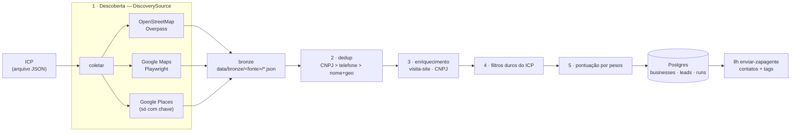

# lead-lakehouse — Arquitetura e funcionamento

> Escrito em 09/09/2026 para uma pessoa entender este sistema **sozinha**, sem quem o construiu
> por perto. Cobre da estrutura de pastas ao caminho que um negócio percorre até virar contato
> no zapagente. Onde o código tem uma decisão que não é óbvia, o motivo está no comentário do
> próprio arquivo; aqui fica o mapa que liga tudo.
>
> O que este documento **não** é: o plano. O plano é [`PLANO.md`](PLANO.md), escrito em
> 25/07/2026, e ele descreve coisas que **não existem no código** — a seção 17 aqui lista quais.
> Este documento fala só do que está escrito nos arquivos hoje, medido arquivo por arquivo.
>
> Branch de trabalho: `refactor/v1-multi-fonte`. A `main` ainda tem a v0.6 (Selenium + DuckDB).

---

## 0 · Como ler

Se você tem dez minutos, leia as seções 1, 2 e 16. Se vai mexer nos critérios de caça, leia 5,
6 e 7. Se vai escrever uma fonte nova, leia 4, 8 e a receita em 14. Se vai mexer no banco, 10.
A seção 15 é o vocabulário; a 17 é a diferença entre o plano e o código; a 18 é o que quebra.

---

## 1 · O sistema em um parágrafo

Um pacote Python (`leadlakehouse`) que responde a uma pergunta: **quem, numa cidade e num
nicho, precisa do que eu vendo?** Você descreve o alvo num arquivo JSON — o **ICP** — e a
ferramenta sai atrás dele em várias **fontes** (OpenStreetMap via Overpass, Google Maps via
Playwright, Google Places se houver chave paga), **colapsa** os registros que são o mesmo
negócio do mundo real, **enriquece** cada um (visita o site, consulta o CNPJ na base aberta da
Receita), aplica os **filtros duros** do ICP, **pontua** a oportunidade com os pesos do ICP e
grava o resultado no Postgres. Depois, um comando separado empurra esses leads para o
**zapagente**, como contatos com tags — é lá que a conversa acontece. Aqui não há disparo de
mensagem nenhum: este repositório encontra e qualifica, o zapagente aborda e fecha.



As **quatro camadas** do pacote, com a dependência sempre apontando para dentro: `interface`
(CLI, Streamlit) chama `app` (orquestração), que usa `domain` (puro, sem I/O) e `infra`/
`sources`/`enrichment`/`integrations` (tudo que toca rede, banco ou browser). O domínio não
importa httpx, SQLAlchemy nem Playwright — é isso que deixa a regra de negócio testável sem
rede e sem banco (33 testes rodam em 0,6 s).

---

## 2 · Mapa do repositório

```
lead-lakehouse/
├── leadlakehouse/
│   ├── config.py               Settings (pydantic-settings). TODA variável é LLH_*
│   ├── domain/                 PURO — sem HTTP, sem SQL, sem browser
│   │   ├── models.py           Business, Sinal, Score, Lead + os enums (Fonte, TipoSinal…)
│   │   ├── icp.py              ICP, Regiao, Filtros, PesosOportunidade e os pesos padrão
│   │   ├── identity.py         normalização (nome/telefone/geo), chave de identidade, dedup
│   │   ├── scoring.py          deriva sinais dos campos e aplica os pesos do ICP
│   │   └── sources.py          os contratos DiscoverySource / EnrichmentSource + Capacidades
│   ├── sources/                fontes de DESCOBERTA (uma por arquivo)
│   │   ├── registry.py         registro em memória; quem consulta é a CLI e o orquestrador
│   │   ├── bootstrap.py        a única lista de fontes ligadas — acrescentar fonte = 1 linha
│   │   ├── openstreetmap.py    Overpass API (livre, sem token, três mirrors)
│   │   ├── google_maps.py      Playwright; extração do DOM isolada do mapeamento puro
│   │   └── google_places.py    API oficial paga; só é registrada se houver chave
│   ├── enrichment/             fontes de ENRIQUECIMENTO
│   │   ├── site_visitor.py     baixa o site: e-mail, WhatsApp, SSL, viewport, tempo
│   │   └── cnpj_enrich.py      minhareceita.org: razão social, CNAE, situação, abertura
│   ├── pipeline/
│   │   └── bronze.py           grava o cru de cada fonte em data/bronze/<fonte>/<ts>.json
│   ├── infra/
│   │   ├── browser.py          BrowserPool Playwright (UA rotativo, stealth, atraso aleatório)
│   │   └── db/
│   │       ├── base.py         engine + Session + criar_tabelas()
│   │       ├── models.py       as 4 tabelas ORM (businesses, icps, leads, runs)
│   │       ├── repository.py   ESCRITA: upsert_business, salvar_lead, abrir/fechar_run
│   │       └── queries.py      LEITURA: leads_df (pandas) e contagens
│   ├── integrations/zapagente/
│   │   └── client.py           cliente HTTP: login, upsert contato, tag, aplicar tag
│   ├── app/                    casos de uso
│   │   ├── prospeccao.py       coletar → dedup → enriquecer → filtrar → pontuar → persistir
│   │   └── envio.py            leads pendentes → zapagente → marca enviado
│   └── interface/
│       ├── cli.py              o comando `llh` (typer)
│       └── streamlit_app.py    a UI; roda a prospecção chamando a CLI por subprocess
├── tests/                      33 testes; nenhum precisa de rede ou banco
├── docs/PLANO.md               o plano de 25/07/2026 (ver seção 17)
├── docs/ARQUITETURA.md         este arquivo
├── docker-compose.yml          o Postgres 16 em :5433 (5432 é do zapagente)
├── pyproject.toml              deps, extras `scraping`/`ui`, o script `llh`, pytest e ruff
├── .env.example                todas as variáveis, sem valor secreto
└── .gitignore                  .env, data/ e dados-recebidos/ nunca entram no git
```

Fora do git, mas presentes na máquina: `.venv/` (Python 3.12 do uv), `data/bronze/` (o cru
coletado) e `dados-recebidos/` (CSV de leads com nome e telefone). **Repositório é público** —
esses três diretórios são exatamente o que não pode vazar, e estão ignorados.

---

## 3 · O ciclo de vida de uma prospecção

O caminho de ponta a ponta de `llh prospectar --icp alvo.json`:

1. **A CLI carrega o ICP.** `cli.prospectar` chama `sources.bootstrap.registrar_todas()` — que é
   o único lugar onde as fontes concretas são ligadas — e valida o JSON com
   `ICP.model_validate_json`. Campo desconhecido ou tipo errado falha aqui, antes de qualquer
   rede. Depois entra no `asyncio.run`.
2. **`app.prospeccao.coletar`** pega as fontes de descoberta registradas e mantém só as que o
   ICP pediu (`icp.fontes` vazio = todas). Roda **uma fonte por vez**, consumindo o
   `AsyncIterator[Business]` de cada uma. Exceção de uma fonte é logada e **não derruba** as
   outras — a prospecção continua com o que deu certo.
3. **Bronze.** Assim que uma fonte termina, o que ela devolveu é serializado inteiro em
   `data/bronze/<fonte>/<timestamp>_<nicho>.json`. É o registro do que a fonte disse, antes de
   qualquer limpeza: se a pontuação sair estranha, é aqui que se confere.
4. **Dedup.** `domain.identity.deduplicar` colapsa os registros que são o mesmo negócio do mundo
   real, cruzando as três fontes (seção 6). Sai uma lista menor de `Business` fundidos.
5. **Enriquecimento.** Cada negócio passa por **todos** os enriquecedores registrados, em
   sequência. Cada um sai na primeira linha se não tem o que fazer (sem site → o visitador não
   baixa nada; sem CNPJ de 14 dígitos → a consulta à Receita nem sai). Erro de um enriquecedor
   vira aviso no log e o negócio segue.
6. **Filtro duro.** `icp.filtros.aprova(b)` decide quem continua. A convenção é dura de propósito
   nos campos booleanos e branda nos numéricos: **dado que falta não elimina ninguém** (seção 5).
7. **Pontuação.** `domain.scoring.pontuar` deriva os sinais que dá para deduzir dos campos,
   junta com os que o enriquecimento coletou, aplica os pesos do ICP e classifica em
   alta/média/baixa/nenhuma pelos limiares.
8. **Tags.** `gerar_tags` monta a lista que vai virar segmentação no zapagente:
   `lead-lakehouse`, `icp-<slug>`, `oportunidade-<nível>`, `nicho-<slug>`, `cidade-<slug>`,
   um `sinal-<tipo>` por sinal e `sem-site` quando for o caso.
9. **Ordenação e persistência.** A lista sai ordenada por score decrescente. Se `--persistir`
   (o padrão), abre um `run`, faz upsert de cada negócio e de cada lead, fecha o `run` e commita
   — tudo numa sessão só.
10. **Saída.** A CLI imprime os `--top` primeiros com score, nível, telefone, se tem site e
    município.

O envio é uma execução separada, `llh enviar-zapagente`: lê do Postgres os leads cujo status
não é `enviado_zapagente`, ordenados por score, descarta quem não tem telefone com pelo menos
8 dígitos, e para cada um faz upsert do contato + garante cada tag + aplica cada tag. Sucesso
grava `status='enviado_zapagente'` e o `zapagente_contato_id`. **Nada é apagado e nada é
disparado** — quem conversa é o zapagente.

---

## 4 · Os módulos

| Arquivo | Responsabilidade | O que NÃO faz |
|---|---|---|
| `config.py` | Uma classe `Settings` com todos os parâmetros, prefixo `LLH_`, lendo `.env`. Instância global `settings` | Não valida se as chaves pagas existem; vazio significa "desligado" |
| `domain/models.py` | As entidades: `Business` (o negócio consolidado), `Sinal`, `Score`, `Lead`, e os enums `Fonte`, `TipoSinal`, `NivelOportunidade`, `LeadStatus` | Não valida regra de negócio; não sabe de banco |
| `domain/icp.py` | `ICP` (quem caçar), `Regiao`, `Filtros` (gates duros) e `PesosOportunidade` (o que vale mais) + `PESOS_PADRAO` | Não decide fonte nem executa nada |
| `domain/identity.py` | Normalizar nome/telefone/geo, produzir as chaves de bloqueio, `chave_identidade`, `mesclar` e `deduplicar` | Não persiste; não sabe qual registro é "mais novo" — quem chega primeiro vence nos escalares |
| `domain/scoring.py` | `derivar_sinais` (o que dá para deduzir dos campos) e `pontuar` (aplica os pesos) | Não coleta sinal nenhum: quem coleta é o enriquecimento |
| `domain/sources.py` | Os dois `Protocol` (`DiscoverySource`, `EnrichmentSource`) e `CapacidadesFonte` (o que a fonte declara sobre si) | Não implementa nada; é só contrato |
| `sources/registry.py` | Dois dicionários em memória: fonte → instância, e o `resumo()` que a CLI imprime | Não instancia fonte sozinho |
| `sources/bootstrap.py` | A lista das fontes ligadas, com guarda de idempotência | Não descobre módulo automaticamente: é lista escrita à mão, de propósito |
| `sources/openstreetmap.py` | Traduz nicho → tag OSM, monta a query Overpass (por área ou por raio), tenta três mirrors, mapeia elemento → `Business` | Não filtra por nota nem avaliação: o OSM não tem esses dados |
| `sources/google_maps.py` | Dirige o Chromium: busca, rola o feed até estabilizar, abre cada ficha, extrai o DOM. O mapeamento `raw_para_business` é puro | Não respeita ToS (`respeita_tos=False`, declarado) e não tem rate limit próprio além do `atraso()` |
| `sources/google_places.py` | A mesma descoberta pela API oficial `places:searchText` | Não roda sem `LLH_GOOGLE_PLACES_API_KEY`; nem é registrada |
| `enrichment/site_visitor.py` | Baixa o site (com fallback sem verificar certificado), deriva SSL/viewport/tempo e cata e-mail e WhatsApp do HTML | Não abre browser: é httpx puro, então site que só monta por JavaScript parece vazio |
| `enrichment/cnpj_enrich.py` | Consulta `minhareceita.org/<cnpj>` e preenche o que estiver faltando | Não descobre CNPJ: só age em negócio que **já** tem um |
| `pipeline/bronze.py` | Serializa a lista de negócios de uma fonte num JSON com timestamp | Não lê o bronze de volta: não existe leitor |
| `infra/browser.py` | `BrowserPool` como context manager assíncrono; UA sorteado, viewport fixo, `navigator.webdriver` apagado, `atraso()` entre ações | Não usa `LLH_CONCORRENCIA` (a coleta é sequencial hoje) |
| `infra/db/base.py` | `engine`, `Session` e `criar_tabelas()` | `create_all` **não altera** tabela que já existe |
| `infra/db/models.py` | As quatro tabelas (seção 10) | Não guarda sinal em tabela própria: sinal é JSON dentro do negócio |
| `infra/db/repository.py` | Toda a escrita, idempotente por chave | Não faz `SELECT` para relatório |
| `infra/db/queries.py` | Toda a leitura da UI: `leads_df` (pandas) e `contagens` | Não escreve nada |
| `integrations/zapagente/client.py` | O contrato HTTP do zapagente, com cache de tag por nome | Não dispara campanha (o endpoint está documentado no cabeçalho, o método não existe) |
| `app/prospeccao.py` | A orquestração inteira + `gerar_tags` | Não fala com o zapagente |
| `app/envio.py` | Seleciona pendentes, envia, marca | Não pontua nem coleta |
| `interface/cli.py` | Os seis comandos do `llh` | Não tem regra de negócio: cada comando importa o que precisa **dentro** da função |
| `interface/streamlit_app.py` | O painel: montar ICP, rodar, ver leads, exportar CSV, enviar | Não chama o orquestrador direto — chama a CLI por `subprocess`, para não brigar com o event loop do Streamlit |

---

## 5 · O ICP — a spec que muda os critérios

Um ICP é um JSON validado por Pydantic. `llh exemplo-icp` escreve um pronto para editar:

| Campo | O que é |
|---|---|
| `nome` | O rótulo; vira `icp_nome` na tabela `leads` e a tag `icp-<slug>` |
| `nicho` | Lista de termos de busca. O OSM traduz para tag; o Maps concatena com a região |
| `regiao` | `municipio` + `uf`, **ou** `lat`/`lng` + `raio_km`. O OSM prefere lat/lng quando existe |
| `fontes` | Quais motores usar. **Vazio = todas as registradas** |
| `filtros` | Os gates duros (abaixo) |
| `pesos` | `PesosOportunidade`: dicionário sinal → peso + os três limiares |
| `limite` | Teto de resultados por execução; cada fonte respeita o seu |

**A convenção dos filtros, que não é óbvia e está no código:** filtro numérico que o negócio não
sabe responder **passa**. Um negócio sem nota não é descartado por `nota_min`. O raciocínio é
que falta de informação não é evidência contrária — quem cuida do ranking é a pontuação. Já os
booleanos (`tem_site`, `tem_instagram`) são gates de verdade: `tem_site: false` elimina todo
mundo que tem site. `tem_whatsapp` é o meio-termo: só descarta quando se **sabe** que difere.

O filtro de CNAE compara por prefixo depois de tirar pontos, barras e traços, então `9602-5`
casa com `9602-5/01`. O de situação compara em caixa alta dos dois lados.

`PESOS_PADRAO` está enviesado para quem vende site: `sem_site` vale 5, `so_redes` e site sem
SSL/não responsivo valem 3, e `sem_whatsapp` vale **-2** — porque um negócio que não tem
WhatsApp não é alcançável pelo zapagente, então vale menos, não mais. Vendendo social media,
o caminho é subir `insta_inativo` e zerar `sem_site` (há teste cobrindo exatamente isso).

---

## 6 · Identidade e dedup

O mesmo salão aparece no OSM, no Maps e na Receita com nomes diferentes. `identity.py` resolve
isso em três passos.

**Normalização.** Nome perde acento, caixa e pontuação (`Salão da Márcia & Cia!` →
`salao da marcia cia`). Telefone vira E.164 brasileiro, tratando DDI discado (`00…`), tronco
antigo (`0` + DDD) e número já com `55`; o que não é plausível vira `None` em vez de virar lixo.
Coordenada vira um bucket de 3 casas decimais — cerca de 111 metros.

**As chaves.** Cada negócio produz **todas** as suas chaves fortes: `cnpj:<14 dígitos>`,
`tel:<E.164>` e `nomegeo:<nome>|<bucket>`. Dois negócios que compartilhem **qualquer uma** delas
são o mesmo do mundo real.

**O colapso.** `deduplicar` faz blocking multi-chave: para cada negócio, procura todos os grupos
já formados que tocam alguma de suas chaves. Se tocar mais de um, **funde os grupos** — é o caso
do registro que só tem telefone encontrando o registro que só tem CNPJ, ambos ligados pelo
mesmo telefone. `mesclar` dá prioridade ao primeiro nos escalares, preenche vazio com o
segundo, faz união de fontes/redes/origem/raw, e nos sinais mantém um por tipo.

Separada disso existe `chave_identidade`, que devolve **uma** chave canônica por prioridade
(CNPJ, depois telefone, depois nome+geo, depois nome) — é ela que vira a coluna
`chave_identidade` no banco e garante o upsert idempotente. O último recurso, quando o negócio
não tem nem nome, é `anon:<hash do raw>` — e esse é um problema conhecido (seção 18).

---

## 7 · Pontuação

Duas origens de sinal, um cálculo só.

**Derivados** (`derivar_sinais`): o que dá para concluir olhando os campos — sem site, só redes
(sem site mas com rede social), negócio novo (abertura nos últimos 24 meses), poucas avaliações
(menos de 10), nota baixa (abaixo de 3,5), tem/não tem WhatsApp. A data de referência é
injetável (`ref`), justamente para o teste não depender do dia em que roda.

**Coletados**: os que o enriquecimento pendurou em `Business.sinais` — site sem SSL, não
responsivo, lento.

`pontuar` junta os dois numa tabela por tipo, com os **coletados sobrescrevendo os derivados**
(medido vence deduzido), soma os pesos do ICP e classifica pelos limiares. O `breakdown` que
vai para o banco guarda peso por sinal, então dá para auditar depois por que aquele lead deu 6.

Os três limiares padrão: alta ≥ 5, média ≥ 3, baixa ≥ 0,5; abaixo disso, nenhuma. Sinal sem
peso definido no ICP vale 0 — não quebra, só não conta.

---

## 8 · As fontes

### OpenStreetMap (Overpass) — livre, sem token, sem ToS

O mapa `NICHO_OSM` traduz 29 termos em português (`salão`, `padaria`, `mecânica`, `pousada`…)
para pares chave/valor do OSM. Termo sem tradução exata cai numa busca por substring no próprio
mapa e, se ainda assim não casar, vira um filtro por nome com regex — bem mais fraco.

A query sai em duas formas: por **raio** (`around:<metros>,<lat>,<lng>`) quando o ICP tem
coordenada, ou por **área administrativa** (`area["name"="<municipio>"]["admin_level"~"8|9|10"]`)
quando só tem o nome da cidade. Busca `node` e `way`, pede `out center tags <limite>`.

Três mirrors públicos em rodízio: 429 (rate limit) e 504 (timeout de gateway) não são erro
fatal, são motivo para esperar e tentar o próximo. Esgotadas as tentativas, loga o último erro
e devolve lista vazia — a prospecção continua. O `User-Agent` é identificável de propósito:
o `overpass-api.de` responde 406 para requisição anônima.

### Google Maps (Playwright) — o que quebra

A parte frágil está toda em `_extrair_raw`: seletores de DOM (`h1`, `button[data-item-id=…]`,
`div.F7nice`) que o Google muda quando quer. O mapeamento `raw_para_business` é puro e tem
teste. A busca rola o feed até a contagem de cartões estabilizar cinco vezes seguidas ou
atingir o limite; entre ações, `atraso()` sorteia uma pausa entre `LLH_DELAY_MIN_MS` e
`LLH_DELAY_MAX_MS`. As coordenadas não saem do DOM: saem da própria URL da ficha, pelo padrão
`!3d<lat>!4d<lng>`. Rede social é catada da lista de todos os `href` da página, e essa lista
**não** vai para o `raw` guardado — só os campos.

### Google Places — a saída paga

Mesma descoberta, pela API oficial, com `X-Goog-FieldMask` pedindo só os campos usados (é o que
controla o custo). Só é registrada em `bootstrap` se `LLH_GOOGLE_PLACES_API_KEY` tiver valor.
Custo zero por padrão é uma decisão, não um esquecimento.

---

## 9 · Enriquecimento

**Visita ao site.** Baixa a página com httpx (não com browser), duas vezes se precisar: primeiro
verificando o certificado, e se a conexão falhar, de novo sem verificar — e aí marca
`site_sem_ssl`. Também marca sem SSL se a URL final for `http://`. Sem a string `viewport` no
HTML, marca `site_nao_responsivo`. Acima de 3 segundos, `site_lento`. Cata o primeiro e-mail
por regex e detecta WhatsApp por `wa.me`, `api.whatsapp.com` e companhia. Só acrescenta sinal
de tipo que ainda não existe no negócio.

**CNPJ.** `GET minhareceita.org/<14 dígitos>` — dados abertos da Receita, grátis, sem chave.
Preenche apenas o que está vazio: razão social, CNAE, situação cadastral, data de abertura
(que é o que faz nascer o sinal `negocio_novo`), município, UF, e-mail e telefone. Qualquer
erro de rede ou status diferente de 200 devolve o negócio intacto — enriquecimento nunca
derruba a prospecção.

Não existe enriquecedor de Instagram, de PageSpeed nem verificação de WhatsApp (seção 17).

---

## 10 · O banco

Postgres 16 em `localhost:5433` (o 5432 é do zapagente), subido pelo `docker-compose.yml` com
usuário/senha/base `llh`/`llh`/`leadlakehouse`. Quatro tabelas, todas nascendo com `tenant_id`
para o dia em que isto virar multi-tenant:

| Tabela | O que guarda | Quem escreve | Quem lê |
|---|---|---|---|
| `businesses` | O negócio consolidado (silver): identidade, contato, categoria/CNAE, nota, geo, e três colunas JSON — `fontes`, `sinais`, `raw`. `UNIQUE (tenant_id, chave_identidade)` | `repository.upsert_business` | `queries.leads_df`, `app/envio.py` |
| `leads` | O negócio pontuado para um ICP (gold): `score`, `nivel`, `tags`, `breakdown`, `status`, `zapagente_contato_id` | `repository.salvar_lead` e `app/envio.py` (marca enviado) | UI e envio |
| `runs` | O manifesto de cada execução: ICP, status, descobertos, novos, erros, início e fim | `repository.abrir_run` / `fechar_run` | ninguém ainda — a UI não mostra runs |
| `icps` | A spec do ICP persistida | **ninguém** — a tabela existe e nada escreve nela | ninguém |

Chaves e índices que importam: `businesses.chave_identidade` (o upsert), `telefone_e164`,
`nome_norm`, `cnae`, `municipio`; `leads.score`, `nivel`, `status`, `icp_nome`. A tabela `leads`
**não** tem UNIQUE: a idempotência vem do `SELECT` por (tenant, business_id, icp_nome) antes de
inserir.

**Migrações não existem.** `llh init-db` chama `Base.metadata.create_all`, que cria tabela que
falta e **não altera** tabela que já existe. `alembic` está declarado no `pyproject.toml` e
instalado no `.venv`, mas não há `alembic.ini`, não há pasta de versões e não há uma única
revisão. Na prática: mudou coluna, ou você escreve o `ALTER TABLE` à mão, ou derruba o volume
do Docker e recria. Isso está registrado como pendência na seção 17.

Sinal não tem tabela: mora em JSON dentro de `businesses.sinais`. O cabeçalho de
`infra/db/models.py` diz por quê — só vale criar `signals` quando alguém precisar consultar
*por sinal*, e ninguém precisa ainda.

---

## 11 · O conector zapagente

O contrato está escrito no cabeçalho de `integrations/zapagente/client.py`, mapeado do repo
`pethrus07/zapagente`: rotas na raiz, sem prefixo `/api`.

| Chamada | Rota | Nota |
|---|---|---|
| `login(email, senha)` | `POST /auth/login` | Devolve JWT (7 dias), que passa a ir em `Authorization: Bearer` |
| `upsert_contato(nome, telefone)` | `POST /contatos` | Idempotente por (tenant, telefone) do lado de lá |
| `garantir_tag(nome)` | `POST /tags` | Idempotente por (tenant, nome); o cliente ainda guarda cache em memória para não repetir a chamada dentro da mesma execução |
| `aplicar_tag(contato_id, tag_id)` | `POST /contatos/:id/tags` | — |
| `enviar_um(nome, tel, tags)` | as três acima em sequência | Devolve o `contato_id`, que é gravado em `leads.zapagente_contato_id` |

**O telefone do zapagente é só dígitos**, sem `+`, mínimo 8 — o cliente converte e recusa o que
for menor. O `transport` é injetável, e é isso que permite testar o fluxo inteiro contra um
`httpx.MockTransport` sem rede (`tests/test_zapagente.py`).

Autenticação: `LLH_ZAPAGENTE_TOKEN` no `.env`, ou `--email`/`--senha` no comando. Sem nenhum dos
dois, `enviar-zapagente` falha com mensagem explicando o que falta, antes de tocar no banco.
`--dry-run` conta os pendentes com telefone válido e não fala com o zapagente.

---

## 12 · Configuração e execução

Toda variável tem prefixo `LLH_` e vive no `.env` (que é gitignored; `.env.example` lista todas,
sem valor). Os nomes, e nada além dos nomes:

| Variável | Para quê |
|---|---|
| `LLH_DATABASE_URL` | A URL do Postgres (padrão: `…@localhost:5433/leadlakehouse`) |
| `LLH_TENANT_ID` | Carimbado em toda linha gravada; `default` hoje |
| `LLH_HEADLESS` | Se o Chromium do Maps abre janela |
| `LLH_CONCORRENCIA` | **Declarada e não usada** — a coleta é sequencial |
| `LLH_DELAY_MIN_MS` / `LLH_DELAY_MAX_MS` | A faixa da pausa aleatória entre ações do browser |
| `LLH_BRONZE_DIR` | Onde o cru é gravado |
| `LLH_PROXY_URL` | Proxy do Chromium; vazio = sem proxy |
| `LLH_GOOGLE_PLACES_API_KEY` | Liga a fonte paga. Vazio = fonte nem é registrada |
| `LLH_PAGESPEED_API_KEY` | **Declarada e não usada** — o enriquecedor de PageSpeed não existe |
| `LLH_ZAPAGENTE_BASE_URL` / `LLH_ZAPAGENTE_TOKEN` | O destino e a credencial do envio |

Instalação, exatamente como no README: `uv sync` (cria o `.venv` com Python 3.12) → `cp
.env.example .env` → `docker compose up -d` → `uv run llh init-db`.

Os extras do `pyproject.toml` são opcionais: `scraping` (Playwright, selectolax) só é preciso
para o Google Maps; `ui` (Streamlit, pandas) só para o painel. Nesta máquina os dois já estão
instalados no `.venv`.

Os seis comandos do `llh`:

| Comando | O que faz | Precisa de |
|---|---|---|
| `llh versao` | Imprime a versão | nada |
| `llh fontes` | Lista as fontes registradas, com browser/pago/ToS | nada (roda offline) |
| `llh init-db` | Cria as tabelas | Postgres de pé |
| `llh exemplo-icp [--saida arquivo.json]` | Escreve um ICP de exemplo | nada |
| `llh prospectar --icp <arquivo> [--top N] [--no-persistir] [--no-enriquecer]` | A prospecção inteira | rede; Postgres se persistir; Chromium se usar Maps |
| `llh enviar-zapagente [--icp-nome X] [--limite N] [--email/--senha] [--dry-run]` | Empurra os pendentes | Postgres; zapagente no ar (exceto `--dry-run`) |

Uma decisão que se vê lendo o `cli.py`: **cada comando importa o que precisa dentro da própria
função**. É o que faz `llh versao` e `llh fontes` responderem sem exigir Postgres, Playwright
nem pandas instalados.

A UI Streamlit não tem atalho registrado em lugar nenhum — não está no `pyproject.toml` nem no
README. É um script Streamlit comum, então o jeito de subir seria apontar o `streamlit run`
para `leadlakehouse/interface/streamlit_app.py`; **não ficou claro para mim se existe um
comando de casa para isso — conferir com o Pedro** e, se não existir, vale registrar um.

---

## 13 · Como conferir

```bash
uv run pytest        # 33 testes
uv run ruff check .  # lint (line-length 100, regras E/F/I/UP/B)
```

Medido em 09/09/2026 no `.venv` do repositório: **33 testes passam em 0,63 s** e o ruff passa
limpo. Nenhum teste abre rede, browser ou banco — o que é justamente o efeito de o domínio ser
puro e de as partes frágeis (o DOM do Maps, o HTTP do zapagente) terem um mapeamento puro
isolado atrás delas.

| Arquivo | O que cobre |
|---|---|
| `tests/test_icp.py` | Os sete gates de `Filtros`, incluindo a regra "dado que falta passa" |
| `tests/test_identity.py` | Normalização de telefone e nome, bucket geográfico, prioridade da chave, mescla e o colapso de duas fontes pelo mesmo telefone |
| `tests/test_scoring.py` | Derivação de sinais, negócio novo com data de referência fixa, o alvo típico (sem site + WhatsApp = 6, alta), pesos customizados e a prioridade do sinal coletado |
| `tests/test_enrichment.py` | `analisar_html` (site ruim, site bom, WhatsApp) e `aplicar_cnpj` |
| `tests/test_sources.py` | O mapeamento do Maps, a tradução nicho→tag do OSM, as duas formas da query Overpass e o elemento sem nome |
| `tests/test_zapagente.py` | O cliente inteiro contra um `MockTransport` que imita a API: login, upsert + tags, e o cache que não recria tag |

O que **não** tem teste: o orquestrador (`app/prospeccao.py`), o envio (`app/envio.py`), o
repositório, a extração de DOM do Maps e a UI. Um teste do orquestrador com fontes falsas em
memória seria barato e pegaria o defeito da contagem de novos descrito na seção 18.

---

## 14 · Receitas

**Rodar a primeira prospecção**
1. `docker compose up -d` e `uv run llh init-db` (só na primeira vez).
2. `uv run llh exemplo-icp --saida alvo.json` e editar nicho, município e filtros.
3. `uv run llh prospectar --icp alvo.json --top 20`.
4. Conferir o cru em `data/bronze/openstreetmap/` se algum número parecer estranho.

**Prospectar sem gravar nada** — `uv run llh prospectar --icp alvo.json --no-persistir`. Útil
para calibrar peso e limiar sem sujar a tabela.

**Prospectar sem gastar tempo de rede em enriquecimento** — acrescente `--no-enriquecer`. Só a
descoberta e os sinais deriváveis dos campos.

**Só o OpenStreetMap (nada de scraping)** — no ICP, `"fontes": ["openstreetmap"]`. É a
configuração legalmente mais confortável: fonte aberta, sem ToS, sem browser.

**Mudar a oferta que você está vendendo** — mexa em `pesos.pesos` no JSON do ICP. Vendendo
social media: `insta_inativo` alto, `sem_site` baixo. Vendendo site: o padrão já serve. Os
limiares (`limiar_alta`/`media`/`baixa`) recalibram a rotulagem sem mexer nos pesos.

**Acrescentar uma fonte de descoberta**
1. Criar `leadlakehouse/sources/<fonte>.py` com uma classe que tenha `capacidades:
   CapacidadesFonte` e `async def descobrir(self, icp) -> AsyncIterator[Business]`.
2. Se o valor ainda não existir, acrescentar em `Fonte` (`domain/models.py`).
3. Registrar em `sources/bootstrap.py` — uma linha.
4. Manter o mapeamento *dado bruto → Business* numa função pura e escrever o teste dela em
   `tests/test_sources.py`. Esse é o padrão da casa e é o que segura a fragilidade.

**Acrescentar um enriquecedor** — igual, em `leadlakehouse/enrichment/`, com
`async def enriquecer(self, negocio) -> Business`, registrando com `registrar_enrichment`. Ele
tem de sair na primeira linha quando não tiver o que fazer, e nunca levantar exceção para fora.

**Acrescentar um tipo de sinal** — o valor em `TipoSinal`, o peso em `PESOS_PADRAO`, e quem o
produz (uma regra em `derivar_sinais` ou um enriquecedor).

**Enviar os leads ao zapagente** — `LLH_ZAPAGENTE_BASE_URL` e `LLH_ZAPAGENTE_TOKEN` no `.env`,
depois `uv run llh enviar-zapagente --dry-run` para ver quantos passam, e sem o `--dry-run` para
valer. Reenviar não duplica: o contato é upsert por telefone lá, e aqui o lead sai da fila ao
mudar de status.

**Ver os leads numa tela** — subir o Streamlit apontando para
`leadlakehouse/interface/streamlit_app.py` (ver a ressalva na seção 12). A aba Leads filtra por
nível, cidade e "só sem site", e exporta CSV. **Esse CSV tem nome e telefone de negócio real:
não vai para o git** (`dados-recebidos/` está ignorado justamente por isso).

**Mudar coluna do banco** — não existe migração. Ou `ALTER TABLE` à mão no Postgres, ou
`docker compose down -v` e `llh init-db` de novo, perdendo tudo.

---

## 15 · Vocabulário interno

| Termo | Significa |
|---|---|
| **ICP** | *Ideal Customer Profile*: o arquivo JSON que descreve quem caçar e o que vale mais. É o "mudar os critérios" sem tocar em código |
| **Business** | O negócio consolidado — a unidade central. Um por mundo real, depois do dedup |
| **Lead** | Um `Business` pontuado contra um ICP. O mesmo negócio pode ser lead de dois ICPs, com scores diferentes |
| **Sinal** | Um fato de oportunidade sobre o negócio (`sem_site`, `site_lento`, `negocio_novo`…). Derivado dos campos ou coletado no enriquecimento |
| **Score / nível** | A soma dos pesos dos sinais, e o rótulo alta/média/baixa/nenhuma pelos limiares |
| **Descoberta / enriquecimento** | Os dois papéis de fonte: achar negócios a partir de um ICP, ou acrescentar dado a um negócio já achado |
| **Bronze** | O JSON cru do que cada fonte devolveu, antes de qualquer limpeza. Silver = `businesses`; gold = `leads` |
| **Chave de identidade** | A chave canônica do negócio, em cascata CNPJ > telefone > nome+geo > nome. É o que torna o upsert idempotente |
| **Chave de bloqueio** | **Todas** as chaves fortes do negócio ao mesmo tempo; é com elas que o dedup funde grupos |
| **Bucket geográfico** | Coordenada arredondada a 3 casas (~111 m), usada na chave nome+geo |
| **Capacidades** | O que a fonte declara sobre si: descobre? enriquece? precisa de browser? é paga? respeita ToS? |
| **Tenant** | O dono dos dados. Uma coluna em toda tabela, sempre `default` hoje |
| **zapagente** | O outro sistema (repo `pethrus07/zapagente`), que recebe os leads como contatos e conversa por WhatsApp |
| **FARO / Supernova** | Os nomes de produto do `PLANO.md`. No código, tudo se chama `lead-lakehouse` / `leadlakehouse` |

---

## 16 · Status em 09/09/2026, medido no código

| Área | Estado | Onde conferir |
|---|---|---|
| Domínio (models, ICP, identity, scoring) | **Pronto e testado.** 20 dos 33 testes são daqui | `leadlakehouse/domain/`, `tests/` |
| Fonte OpenStreetMap | **Pronta.** 29 nichos mapeados, 3 mirrors, duas formas de query | `sources/openstreetmap.py` |
| Fonte Google Maps | **Pronta**, com a fragilidade esperada de scraping de DOM | `sources/google_maps.py` |
| Fonte Google Places | **Pronta e desligada** (custo zero por padrão) | `sources/bootstrap.py` |
| Enriquecimento site + CNPJ | **Pronto** | `enrichment/` |
| Pipeline | **Só bronze.** Silver e gold não são camadas de código: são as tabelas `businesses` e `leads` gravadas pelo repositório | `pipeline/bronze.py` |
| Banco | **4 tabelas criadas**; `icps` nunca é escrita; `runs` nunca é lida | `infra/db/models.py` |
| Migrações | **Não existem.** `alembic` é dependência declarada e instalada, sem `alembic.ini`, sem versões | `pyproject.toml`, `infra/db/base.py` |
| CLI | **Pronta**, seis comandos | `interface/cli.py` |
| UI Streamlit | **Funciona**, sem atalho registrado para subir; nenhum teste | `interface/streamlit_app.py` |
| Conector zapagente | **Pronto** para contato + tag; **campanha não existe** (só está documentada no cabeçalho) | `integrations/zapagente/client.py` |
| Testes | **33 passando em 0,63 s**, sem rede e sem banco. Ruff limpo | `uv run pytest` |
| Multi-tenant | **Estrutura pronta, uso nenhum**: `tenant_id` em toda tabela, sempre `default` | `config.py`, `infra/db/models.py` |
| Comentários no código | Todo módulo de `leadlakehouse/` e de `tests/` abre com um cabeçalho dizendo o que é e por quê | — |

---

## 17 · O que o `PLANO.md` promete e não existe

O `PLANO.md` é de 25/07/2026 e a tabela de estado dele marca F0–F5 como concluídas. Boa parte
está mesmo, mas estas peças **não estão no código de hoje**:

| Prometido | Onde | Realidade |
|---|---|---|
| **Descoberta por CNPJ/CNAE** ("todas as farmácias de Bayeux numa query") | §4 Tier 0, §12 F2 | Não existe `sources/cnpj.py`. CNPJ é **só enriquecimento**, e só de quem já tem CNPJ. O próprio plano registra isso nas "pendências conhecidas" |
| **Instagram** como fonte e enriquecedor | §4 Tier 1 | Não existe. O valor `Fonte.INSTAGRAM` está declarado no enum, e nada o produz |
| **SERP, Facebook, Bing, Foursquare, diretórios, marketplaces** | §4 Tier 1 e 2 | Não existem. Só os valores no enum `Fonte` |
| **PageSpeed / Lighthouse** | §4 enriquecimento | Não existe. `LLH_PAGESPEED_API_KEY` está no `.env.example` e no `config.py`, sem nenhum leitor |
| **`whatsapp_check.py`** | §8 | Não existe. WhatsApp só é detectado de raspão, pelo HTML do site |
| **Verificação de e-mail (MX/SMTP)** | §4 | Não existe |
| **Alembic** | §3, §8, §13 | Dependência declarada e instalada; nenhuma migração criada |
| **`infra/cache.py`** | §8 | Não existe. Não há cache de nada |
| **Tabela `signals`** e coluna **`geohash`** | §9 | Sinal é JSON dentro de `businesses`; o bucket geográfico só existe em memória, no dedup |
| **Fila Arq/Redis, FastAPI, billing** (F6) | §12 | Fora de escopo, marcado como futuro no próprio plano — coerente |
| **`disparar_campanha`** no conector | §7 | O endpoint está descrito no cabeçalho do cliente; o método não foi escrito |
| **selectolax / BeautifulSoup** para parsing | §3 | `selectolax` é extra declarado e instalado, e nada o importa. O visitador de site usa regex sobre o HTML cru |
| **Renomear o repo para `faro`** | §8, §15-B | Decisão aberta, nunca tomada. Vale decidir: hoje o repo, o pacote e a CLI se chamam lead-lakehouse, e só a documentação fala em FARO |
| **Decisões abertas A–D** | §15 | A (Postgres) e D (pagos desligados) foram respondidas pelo código. **B** (nome) e **C** (ordem das fontes) continuam abertas |

---

## 18 · Armadilhas conhecidas

- **`chave_identidade` pode não ser estável entre execuções.** Negócio sem CNPJ, sem telefone e
  sem nome cai no último recurso `anon:<hash(repr(raw))>`, e o `hash()` de string do Python é
  aleatorizado por processo (`PYTHONHASHSEED`). O mesmo negócio coletado em duas execuções vira
  **duas linhas** em `businesses`. Na prática é raro (fonte sem nome é descartada antes), mas é
  um defeito real; a correção seria um hash determinístico.
- **A contagem de "novos" no `run` está errada.** Em `app/prospeccao._persistir` há um contador
  `novos` que é incrementado e nunca usado: o que vai para o banco é `novos=len(leads)`, ou
  seja, o total, não os inéditos. `runs.novos` sempre igual a `runs.descobertos` filtrados. Não
  quebra nada, mas o número não significa o que o nome diz.
- **O enriquecimento roda antes do filtro.** Um ICP com `tem_site: false` ainda paga a visita ao
  site de todo negócio que **tem** site, para depois descartá-lo. Em coleta grande, é a maior
  parte do tempo de execução. Inverter a ordem (filtrar o que já dá para filtrar, enriquecer,
  filtrar de novo) resolveria — mas muda comportamento, então fica registrado, não feito.
- **O fallback da nota no Google Maps não funciona.** Em `_extrair_raw`, `nota_aria` lê o
  atributo `aria-hidden` (cujo valor é a string `"true"`), não a nota. Quando o texto do
  seletor falha, o fallback nunca produz número. Efeito: nota fica `None` em vez de errada —
  inofensivo, mas o código promete algo que não entrega.
- **`registrar_todas()` só roda uma vez por processo.** A guarda `_carregado` é global; mudar
  `LLH_GOOGLE_PLACES_API_KEY` em tempo de execução não registra a fonte paga depois disso.
- **O `engine` do SQLAlchemy é criado na importação de `infra/db/base.py`.** Ele não conecta
  antes do primeiro uso, então importar sem Postgres de pé não explode — mas uma URL inválida
  no `.env` estoura na importação, e não onde você esperaria.
- **`create_all` não altera tabela existente.** Rodar `llh init-db` depois de mudar uma coluna
  não faz nada e não avisa. Ver seção 10.
- **O nicho entra na query Overpass sem escape.** Termo sem tradução em `NICHO_OSM` vira
  `["name"~"<nicho>",i]`; aspas ou caractere de regex no nicho quebram a query (o município é
  limpo de aspas, o nicho não).
- **O visitador de site é httpx, não browser.** Site que monta o conteúdo por JavaScript parece
  vazio: sem e-mail, sem WhatsApp, e provavelmente `site_nao_responsivo` por falta da string
  `viewport`. Falso positivo de sinal.
- **O Google Maps declara `respeita_tos=False` e nada impede o uso.** A declaração é honesta e
  aparece em `llh fontes`, mas é informação, não trava. O `PLANO.md` §11 é a postura combinada:
  preferir OSM/CNPJ, rate baixo, uso próprio.
- **Docker Desktop instável nesta máquina derruba o Postgres** (registrado no `PLANO.md`): erro
  de conexão em prospecção que estava funcionando geralmente é o container caído, não o código.
- **`data/`, `dados-recebidos/` e `.env` são a linha da LGPD.** O repositório é público. Esses
  três estão no `.gitignore` e é assim que tem de continuar: `dados-recebidos/` tem CSV com nome
  e telefone de negócio real.
