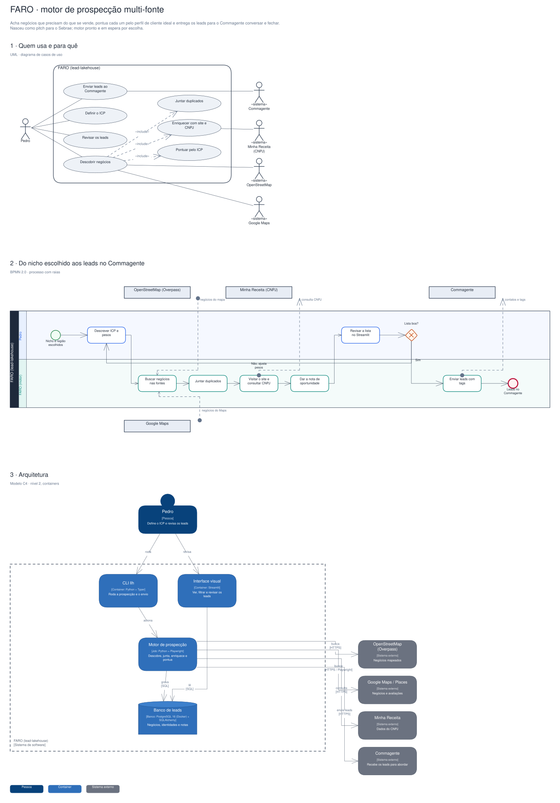

# Arquitetura

Diagramas gerados a partir do Sinapse (o segundo cérebro do Pedro). Cada projeto tem três vistas,
cada uma numa notação padrão:

1. **Quem usa e para quê**: UML, diagrama de casos de uso.
2. **O processo principal**: BPMN 2.0, com raias por quem executa.
3. **A arquitetura**: modelo C4, nível 2 (containers).

## FARO · motor de prospecção multi-fonte

Acha negócios que precisam do que se vende, pontua cada um pelo perfil de cliente ideal e entrega os leads para o Commagente conversar e fechar. Nasceu como pitch para o Sebrae; motor pronto e em espera por escolha.

Editável: [`faro.excalidraw`](./faro.excalidraw), abre em [excalidraw.com](https://excalidraw.com) ou no VS Code com a extensão Excalidraw.

A fonte destes arquivos é o vault do Sinapse (`09-DESENHOS/`); alterações feitas aqui são sobrescritas na próxima publicação.
